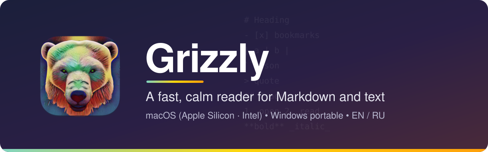
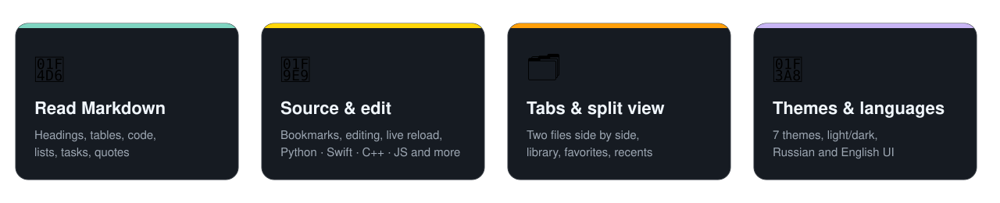
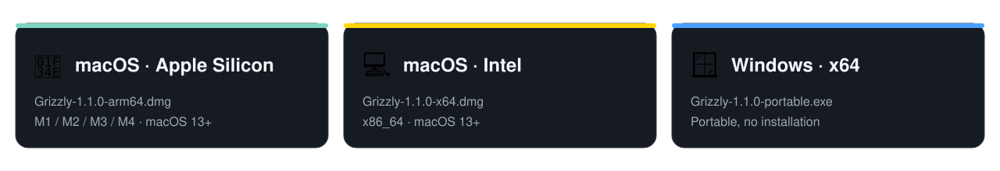

<p align="center">
  
</p>

<p align="center">
  <a href="https://github.com/Slipcast-dev/Grizzly/releases/latest"></a>
  <a href="LICENSE"></a>
  <a href="https://github.com/Slipcast-dev/Grizzly/actions/workflows/ci.yml"></a>
  
  
</p>

<p align="center">
  <b>English</b> · <a href="README.ru.md">Русский</a> · <a href="docs/README.md">Documentation</a> · <a href="CHANGELOG.md">Changelog</a>
</p>

---

**Grizzly** is a small reader for Markdown and plain-text files. It opens a document, renders it the way you
would like to read it, and gets out of the way. The macOS app is native (SwiftUI); the Windows app is a
portable Electron port with the same features.

<p align="center">
  
</p>

## Download

<p align="center">
  
</p>

Get the files from the **[latest release](https://github.com/Slipcast-dev/Grizzly/releases/latest)**.

| Platform | File | Notes |
|---|---|---|
| macOS 13+, Apple Silicon | `Grizzly-0.1.0-arm64.dmg` | Drag *Grizzly* to *Applications* |
| macOS 13+, Intel | `Grizzly-0.1.0-x64.dmg` | Drag *Grizzly* to *Applications* |
| Windows 10/11, x64 | `Grizzly-0.1.0-portable.exe` | Portable, no installer |

> [!IMPORTANT]
> The builds are **not code-signed or notarized**. macOS Gatekeeper and Windows SmartScreen will warn on first
> launch. See [Installation](docs/en/installation.md) for the exact steps, and verify the SHA-256 checksums
> published in the release notes before running anything you downloaded.

## Features

- **Reading mode** — Markdown with headings, lists, task lists, quotes, code blocks, tables and links.
- **Source mode** — line numbers, clickable line **bookmarks** (kept between sessions), syntax colors for
  JSON, YAML, INI/TOML, XML/HTML, TeX and log files.
- **Edit mode** — edit and save in place; the original encoding (UTF-8 with/without BOM, UTF-16, Windows-1251,
  ISO-8859-1) is preserved.
- **CSV / TSV tables** with automatic delimiter detection.
- **Find** with live highlighting, next / previous match.
- **Tabs** and **two files side by side**.
- **Virtual library** — folders, recents and favorites that never touch your files.
- **Live reload** — a banner appears when the file changes on disk (handy for files written by scripts or AI tools).
- **7 themes** (Xcode, GitHub, Solarized, Dracula, Monokai, Nord, One Dark), light / dark / follow system,
  font and size choices.
- **English and Russian** interface.

Supported extensions: `md markdown mdown txt text log json yaml yml csv tsv xml html htm ini conf toml tex rtf`.

## Quick start

1. Download the file for your platform from the [release page](https://github.com/Slipcast-dev/Grizzly/releases/latest).
2. Follow [Installation](docs/en/installation.md).
3. Open a file (`⌘O` / `Ctrl+O`) or drag it onto the window. Try the files in [`samples/`](samples).

## Keyboard shortcuts

| Action | macOS | Windows |
|---|---|---|
| Open | `⌘O` | `Ctrl+O` |
| Save | `⌘S` | `Ctrl+S` |
| Close tab | `⌘W` | `Ctrl+W` |
| Find / next / previous | `⌘F` / `⌘G` / `⇧⌘G` | `Ctrl+F` / `Ctrl+G` / `Ctrl+Shift+G` |
| Next / previous tab | `⇧⌘]` / `⇧⌘[` | `Ctrl+Shift+]` / `Ctrl+Shift+[` |
| Two files side by side | `⌘\` | `Ctrl+\` |
| Reading / Source / Edit | `⌥⌘1` / `⌥⌘2` / `⌥⌘3` | `Ctrl+Alt+1` / `2` / `3` |
| Reload file | `⌘R` | `Ctrl+R` |
| Larger / smaller text | `⌘+` / `⌘-` | `Ctrl++` / `Ctrl+-` |

More in the [User guide](docs/en/usage.md).

## Privacy and security

Grizzly works fully offline: no telemetry, no network access, no accounts. The Windows app runs its UI in a
sandboxed renderer with context isolation and a strict Content-Security-Policy. Report vulnerabilities
privately — see [SECURITY.md](SECURITY.md).

## Build from source

```bash
# macOS (Command Line Tools are enough)
./scripts/build-app.sh && ./scripts/make-dmg.sh

# Windows port (Electron)
cd electron && npm ci && npm run dist
```

Details: [Building](docs/en/building.md) · Design notes: [Architecture](docs/en/architecture.md).

## Contributing

Issues and pull requests are welcome — read [CONTRIBUTING.md](CONTRIBUTING.md) and the
[Code of Conduct](CODE_OF_CONDUCT.md) first.

## License

[MIT](LICENSE) © 2026 Slipcast-dev
